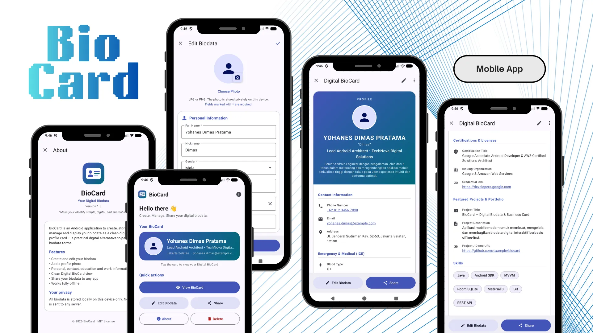
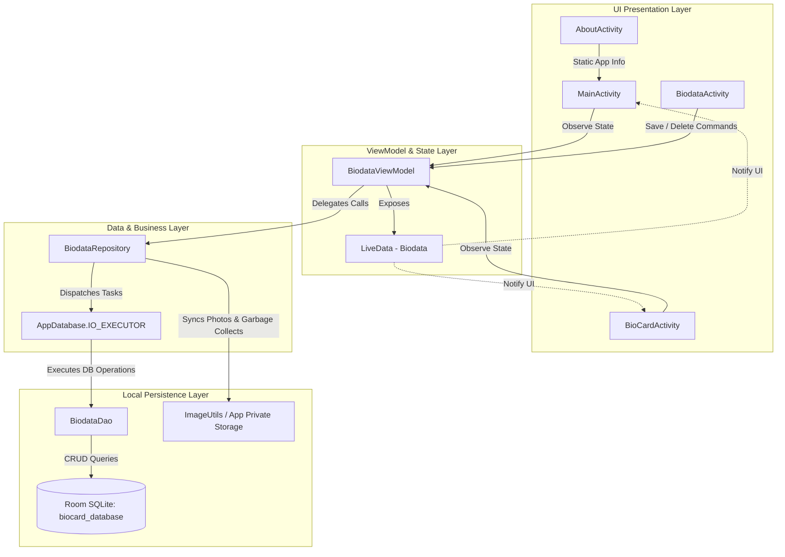
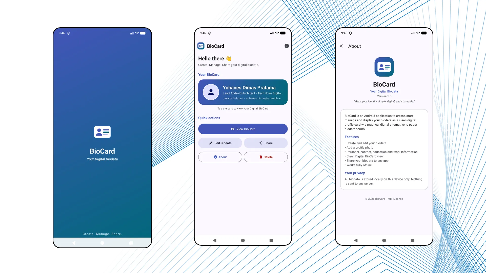
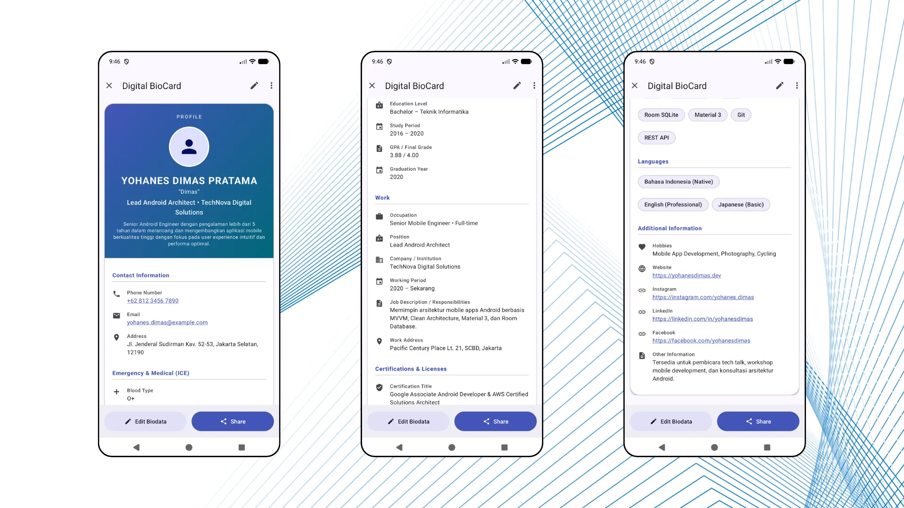
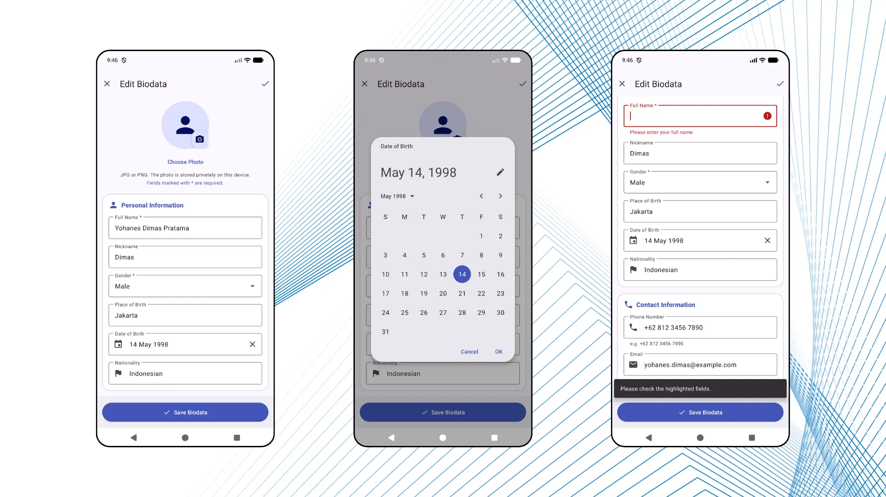

# BioCard




## Project Overview

BioCard is an offline-first native Android application designed to modernize personal and professional profile management by transforming conventional paper biodata forms into an interactive, visually structured digital card. Built with Java and modern Android Jetpack architecture, the application addresses the friction of manual identity presentation and physical document distribution by consolidating personal details, emergency medical information, educational history, career milestones, certifications, and portfolio links into an accessible format. It caters to professionals, job seekers, students, and event attendees who require a polished, privacy-respecting digital profile that operates entirely offline without external server tracking or telemetry.

## Key Features

- **Multi-Category Profile Builder**: Comprehensive data entry covering personal details, contact points, educational history, work experience, certifications, portfolio projects, and spoken languages.
- **Privacy-Preserving Photo Picker**: Seamless profile picture selection utilizing Android's modern photo picker API without requesting broad runtime device storage permissions.
- **Interactive Digital BioCard**: Consolidated and responsive digital business card interface presenting categorized profile sections with auto-formatting and actionable external links.
- **Emergency & Medical Information (ICE)**: Dedicated In-Case-of-Emergency section capturing critical health information, blood types, medical notes, and immediate contact details.
- **Dynamic Chip Visualizations**: Interactive, tagged chip components for visual categorization of technical skills and multilingual competencies.
- **Real-Time Input Validation**: Inline validation mechanics ensuring formatting accuracy for telephone numbers, email addresses, graduation years, and web URLs.
- **Universal System Sharing**: Native Android share intent integration allowing users to dispatch their formatted textual biodata to any messaging platform, email client, or note-taking app.
- **Complete Local Persistence**: Resilient local-first database operations powered by Android Jetpack Room with automatic orphan image garbage collection.

## Supported Platforms

| Platform | Operating System | Minimum Version | Support / Test Status |
|---|---|---|---|
| Mobile | Android | Android 8.0 (Oreo) / API Level 26 | Supported / Active |

## Tech Stack

| Category | Technology | Purpose |
|---|---|---|
| Platform | Android SDK | Native mobile execution platform targeting modern Android runtimes (API 26–36) |
| Programming Language | Java 17 | Primary application logic, data modeling, and asynchronous event execution |
| Architecture Pattern | MVVM (Model-View-ViewModel) | Structural separation between business logic, view controllers, and data layers |
| UI Toolkit | Material Design Components 3 | Android UI framework delivering modern components, typography, and card layouts |
| View Binding | Android Jetpack ViewBinding | Compile-time type-safe interaction with XML activity and layout structures |
| Local Database | Android Jetpack Room | SQLite object-relational mapping abstraction for local-first structured storage |
| Reactive State | Android Jetpack LiveData & ViewModel | Lifecycle-aware data observation and surviving configuration changes |
| Asynchronous Execution | ExecutorService & Main Thread Handler | Multi-threaded background operations ensuring smooth UI rendering during disk I/O |
| Build System | Gradle Wrapper | Automated compilation, resource minification, and packaging pipeline |
| Unit Testing | JUnit 4 | Local unit testing verifying date transformations, validation utilities, and share strings |

## Application Architecture

BioCard follows the recommended Android MVVM (Model-View-ViewModel) architectural pattern combined with a Repository pattern to enforce strict separation of concerns, maintainability, and clean data flow. The user interface layer comprises native Activities (`MainActivity`, `BiodataActivity`, `BioCardActivity`, and `AboutActivity`) utilizing Android Jetpack ViewBinding to safely render views and handle user gestures. These activities observe observable state emitted by `BiodataViewModel` via `LiveData`. The ViewModel delegates all persistence and business operations to `BiodataRepository`, which manages thread execution through an isolated `ExecutorService`. The repository interfaces directly with `AppDatabase` through `BiodataDao` to execute SQLite operations, while simultaneously coordinating with `ImageUtils` to save profile photos in the application's sandboxed private storage and clean up unreferenced image files.



## Screenshots / Preview

### 1. Splash Screen, Home Dashboard & About Screen

The application welcomes users with an animated brand splash screen before directing them to the primary home dashboard, featuring an immediate overview card, quick action buttons, and a comprehensive about screen detailing version metadata and local privacy guarantees.

### 2. Comprehensive Digital BioCard Interface

The full digital card interface consolidates user identity attributes across dedicated card sections, including contact channels with interactive dialer/email intents, emergency medical data, career milestones, educational degrees, and styled skill chips.

### 3. Biodata Input Form & Validation Workflows

The structured profile creation form provides focused input fields for all personal and professional categories, incorporating an interactive Material date picker dialog alongside real-time inline validation feedback for required fields and formatting rules.

## Prerequisites

- **Java Development Kit (JDK)**: Version 17 or higher.
- **Android Studio**: Android Studio Ladybug (2024.2.1) or higher recommended.
- **Android SDK**: Compile SDK set to API Level 36, with Build Tools installed.
- **Target Device / Emulator**: Physical device or Android Virtual Device (AVD) running Android 8.0 (API Level 26) or later.
- **Build Tooling**: Gradle 8.x configured with the Android Gradle Plugin.

## Installation & Setup

1. **Clone the repository**:
   ```bash
   git clone https://github.com/weztcy/BioCard---Digital-Biodata.git
   cd "BioCard - Digital Biodata"
   ```

2. **Open the project**:
   Launch Android Studio, select **Open**, and navigate to the cloned project root folder.

3. **Sync Gradle dependencies**:
   Allow Android Studio to sync Gradle and download required Jetpack and Material components:
   ```bash
   ./gradlew build --refresh-dependencies
   ```

4. **Assemble debug APK**:
   Compile the debug APK using the Gradle wrapper:
   ```bash
   # On macOS/Linux
   ./gradlew assembleDebug

   # On Windows PowerShell
   .\gradlew.bat assembleDebug
   ```

5. **Deploy to connected device or emulator**:
   Install and run the application directly from the command line or via Android Studio's **Run** action:
   ```bash
   ./gradlew installDebug
   ```

## Application Configuration

BioCard relies on standard Android Gradle manifest properties and Room configurations without requiring external environment configuration files or remote endpoints.

| Configuration | Description | Default / Example |
|---|---|---|
| `applicationId` | Unique package namespace on Android runtimes | `com.example.biocard` |
| `minSdk` | Minimum Android API level required to execute the app | `26` (Android 8.0 Oreo) |
| `targetSdk` | Target Android SDK version for platform feature parity | `36` (Android 15+) |
| `compileSdk` | Android SDK level used during compilation | `36` |
| `versionCode` | Monotonically increasing build version identifier | `1` |
| `versionName` | Human-readable application release version string | `1.0` |
| `Database Name` | Local SQLite database file identifier managed by Room | `biocard_database` |
| `Database Version` | Schema migration version tracking Room entity structures | `1` |

## Database & Local Storage

BioCard adopts an offline-first persistence model leveraging Android Jetpack Room as an abstraction layer over an embedded SQLite database. Data writes and updates are executed on a dedicated background thread pool (`AppDatabase.IO_EXECUTOR`) to ensure zero blockage of the main UI thread. Profile photos selected via the Android Photo Picker are copied directly into the app's internal sandboxed directory (`Context.getFilesDir()`), preventing unauthorized external file modifications and eliminating external storage permissions. When biodata is deleted or profile photos are replaced, an orphan-clearing mechanism purges obsolete image files from the filesystem.

| Storage Component | Technology | Role & Purpose | Storage Path / Location |
|---|---|---|---|
| Profile Data Table | Room ORM / SQLite | Stores structured profile attributes, education, work, and emergency records | `databases/biocard_database` |
| Profile Photos | File System Sandbox | Private storage holding user-selected JPEG/PNG avatar assets | `files/profile_photo_*.jpg` |

```java
// Room Database initialization with singleton thread executor
@Database(entities = {Biodata.class}, version = 1, exportSchema = false)
public abstract class AppDatabase extends RoomDatabase {
    public static final ExecutorService IO_EXECUTOR = Executors.newFixedThreadPool(2);
    // ... singleton instance accessor
}
```

## Testing

The project includes unit test coverage targeting mission-critical data transformations, date parsers, input validation criteria, and string formatting utilities located under `app/src/test/java/com/example/biocard/utils/`.

- **Validation Utilities**: Verifies mandatory constraints, RFC-compliant email matching, phone digit thresholds (6–15 digits), and valid year boundaries (`ValidationUtilsTest`).
- **Date Parsers & Formatters**: Tests ISO-8601 string parsing, localized display outputs, and edge cases (`DateUtilsTest`).
- **Share String Assembler**: Validates markdown-styled textual biodata generation, delimiter joining, and null-safe value concatenation (`ShareUtilsTest`).

Execute local unit tests using the Gradle wrapper:

```bash
# On macOS/Linux
./gradlew testDebugUnitTest

# On Windows PowerShell
.\gradlew.bat testDebugUnitTest
```

## Build & Packaging

The application supports automated compilation of installable APKs through Gradle build variants, including automated resource shrinking and code minification via R8/ProGuard.

1. **Verify dependencies and compile resources**:
   ```bash
   ./gradlew clean
   ```

2. **Generate signed or debug APK packages**:
   ```bash
   # Build optimized release APK
   ./gradlew assembleRelease

   # Build development debug APK
   ./gradlew assembleDebug
   ```

3. **Locate packaged artifacts**:
   Generated APK files are located at:
   - Debug: `app/build/outputs/apk/debug/app-debug.apk`
   - Release: `app/build/outputs/apk/release/app-release-unsigned.apk` (or signed per configuration)

## Device Features & Permissions

BioCard is architected with a zero-permission philosophy. It avoids requesting dangerous runtime permissions such as `READ_EXTERNAL_STORAGE` or `CAMERA` by utilizing modern platform abstractions.

| Feature / Intent | Purpose | Platform Integration |
|---|---|---|
| System Photo Picker | Selecting user avatars without disk read permissions | `ActivityResultContracts.PickVisualMedia` |
| System Share Sheet | Sharing formatted textual biodata to messaging/social apps | `Intent.ACTION_SEND` (MIME: `text/plain`) |
| Dial & Email Actions | Launching phone dialer and mail clients directly from cards | `Intent.ACTION_DIAL` & `Intent.ACTION_SENDTO` |
| Web Browser Launch | Opening portfolio, credential, and project URLs | `Intent.ACTION_VIEW` |

## Usage

BioCard enables users to create, manage, and present their professional profile with minimal setup:

1. **Launch the Application**: Open BioCard on your Android device to reach the home dashboard.
2. **Create Biodata**: Tap **Create Biodata** to open the multi-section data form.
3. **Attach Profile Photo**: Click the avatar placeholder to launch the system photo picker and choose a profile picture.
4. **Complete Profile Fields**: Fill in personal information, contact numbers, emergency ICE contacts, education, career experience, and comma-separated skills.
5. **Save Profile**: Tap **Save Biodata** to validate inputs and persist records to the Room database.
6. **Inspect Digital BioCard**: Tap **View BioCard** on the dashboard to review your unified, interactive virtual profile card.
7. **Share Across Channels**: Tap the **Share** button from either the dashboard or the BioCard view to launch the native Android share sheet and export your profile as formatted text.
8. **Update or Purge Data**: Access **Edit Biodata** to modify existing records, or click **Delete** from the options menu to completely purge your biodata and stored avatar from local storage.

## Contributing

Contributions to improve BioCard's functionality, UI design, and platform integrations are welcome. Follow these steps to contribute:

1. Fork the repository on GitHub.
2. Create a dedicated feature branch (`git checkout -b feature/amazing-feature`).
3. Implement your changes, adhering to existing Java code formatting and MVVM architecture.
4. Execute unit test suites (`./gradlew testDebugUnitTest`) to ensure stability.
5. Commit your changes with clear, descriptive commit messages (`git commit -m 'Add amazing feature'`).
6. Push the branch to your fork (`git push origin feature/amazing-feature`).
7. Open a Pull Request detailing the changes, context, and verification steps.

## License

This project is licensed under the MIT License.
See the [LICENSE](LICENSE) file for details.

## Author & Contact

**Yohanes Dimas Pratama**

- GitHub: [github.com/weztcy](https://github.com/weztcy)
- Portfolio: [yohanesdimas.com](https://yohanesdimas.com)
- LinkedIn: [linkedin.com/in/yohanes-dimas](https://www.linkedin.com/in/yohanes-dimas)
